# Nemesis Usage Guide

This page covers usage of Nemesis after the system is properly [setup](quickstart.md).

For a general overview of the Nemesis project structure, see the [overview](overview.md).

- [Nemesis Usage Guide](#nemesis-usage-guide)
  - [Data Ingestion](#data-ingestion)
    - [Nemesis C2 Connector Setup](#nemesis-c2-connector-setup)
  - [Nemesis Dashboard](#nemesis-dashboard)
    - [Files](#files)
      - [Paging, Links and Live Updates](#paging-links-and-live-updates)
      - [File Triage Mode](#file-triage-mode)
      - [File Details](#file-details)
      - [File Tags](#file-tags)
    - [Manual File Upload](#manual-file-upload)
    - [Document Search](#document-search)
    - [Findings](#findings)
      - [Keyboard Shortcuts](#keyboard-shortcuts)
    - [Dashboard Settings](#dashboard-settings)
  - [Alerting](#alerting)
  - [Submitting Files via the API](#submitting-files-via-the-api)
    - [API Documentation](#api-documentation)

## Data Ingestion

Once Nemesis is running, data first needs to be ingested into the platform. Ingestion into Nemesis can occur in multiple ways, including:

* [Auto-ingesting data from C2 platforms](#nemesis-c2-connector-setup), including Mythic, Cobalt Strike and Outflank C2.
* [Manually uploading files on the "File Upload" page in the Nemesis Dashboard UI.](#manual-file-upload)
* [Using the CLI tool](./cli.md) to:
    * [submit individual files or entire folders/subfolders](./cli.md#file-submission)
    * [monitor a folder for new files and auto-submit them](./cli.md#folder-monitoring).
* Writing custom tools to interact with [Nemesis's API](#api-documentation).

### Nemesis C2 Connector Setup

Nemesis includes connectors for [Mythic](https://github.com/its-a-feature/Mythic), Cobalt Strike and Outflank C2 (formerly Stage1). The connectors hook into the C2 platforms and transfer data automatically into Nemesis. The connectors are located in the [CLI](https://github.com/SpecterOps/Nemesis/tree/main/projects/cli/cli/) project.

See the [CLI](./cli.md) documentation for more details on configuration.

## Nemesis Dashboard

The main method for operators/analysts to interact with Nemesis data is through the Nemesis Dashboard. The dashboard can be accessed at `https://NEMESIS_IP_OR_HOST:7443/`. The initial display shows details about the number of processed files and enrichment workflow information:

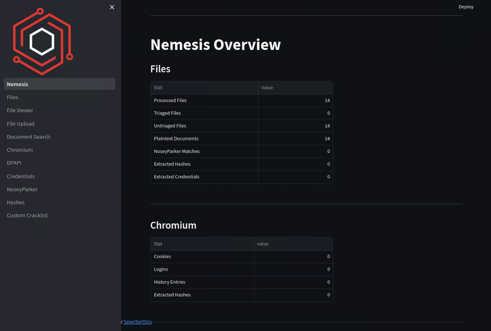

### Files

To analyze files in Nemesis, visit the `Files` page in the left navigation pane:

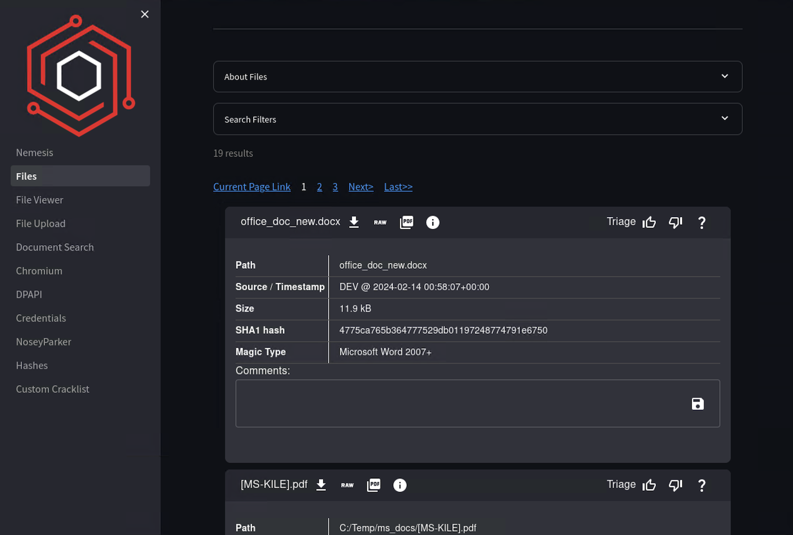

As Nemesis processes files, they appear as a new row on this page. By default, Nemesis displays all uploaded files from newest to oldest. Clicking on a column header sorts by that column (clicking it again reverses the order), and the toolbar allows filtering the list in various ways. The number of matching files is shown at the right of the toolbar.

Each file's path has a blue dot to the left of it indicating if you have viewed it or not. Clicking on the row will bring you to the [File Details](#file-details) page and marks the file as viewed by you. Returning to the Files page, the blue indicator dot won't be present anymore. To only show files you have not viewed yet, you can click the dropdown in the top left of the toolbar and select one of the following options:

- `All Files` - Shows all files (the default).
- `Files Unviewed by Me` - Shows only files that **you** have not analyzed yet.
- `Unviewed Files` - Shows files that **nobody** has analyzed (including you). This is useful when triaging files as a team.

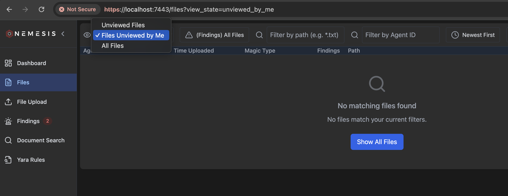


Some files may have findings associated with them. To show only files that have findings, click the "(Findings) All Files" button (it then reads "(Findings) Files With Findings"; click it again to show all files).

Use the "Filter by path" search box to filter files by path/name/extension (`*` is a wildcard, e.g. `*.txt`; without a `*` the text matches anywhere in the path). Similarly, you can use the "Filter by source" box to filter files by their source (e.g., the agent/host they were collected from).

On the File Details page you can [view and add tags](#file-tags) to a file. The "Filter by Tag" button allows you to filter the file list to particular tags.

#### Paging, Links and Live Updates

The Files and [Findings](#findings) lists are paginated on the server: each page shows 100 rows, and the bar at the bottom of the list shows which rows are displayed out of the total number of results (e.g. "Showing 101 to 200 of 5,432 files") along with page navigation buttons.

The current filters, sort order and page number are all stored in the page's URL, so:

- A filtered/sorted view can be bookmarked or shared with a teammate by copying the URL.
- The browser's Back/Forward buttons restore previous filters, sort orders and pages.
- Returning from a file's [details](#file-details) (with the `Back` button or `←`) brings you back to the same page, row and filters you left.

The lists update live: when new files/findings arrive, or when you or a teammate views or triages something, the current page and the total count refresh automatically.

Outside of triage mode, `PageUp`/`PageDown` scroll the list by about three quarters of its height; pressing `PageDown` at the bottom of the list (or `PageUp` at the top) moves to the next (or previous) page.

#### File Triage Mode

File Triage Mode is very convenient when you want to quickly navigate and view/triage files and findings with the keyboard.
To enter File Triage Mode, hit the `t` key on the Files page (press `t` again to leave it):

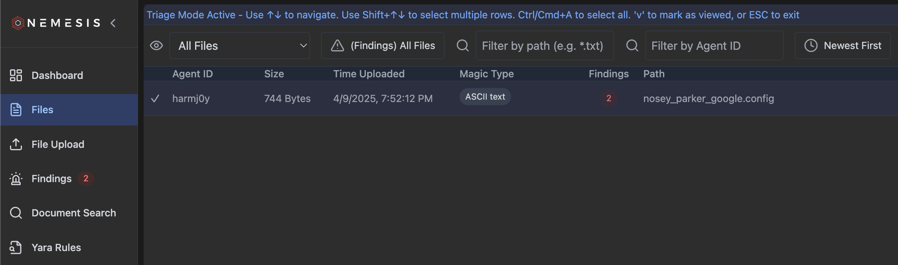

In triage mode, the **active row** (the one the keyboard acts on) is drawn with an outline. Selected rows show a ✓ in the left column and a filled blue highlight. Actions (`v`, `1`/`2`/`3`) apply to the selected rows, or to the active row when nothing is selected.

The following actions are possible (a summary is also shown in the bar at the top of the page):

- `Up/down(↑↓) arrow` - Move the active row up and down. Moving past the first/last row of a page continues onto the previous/next page.
- `PageUp`/`PageDown` - Jump about three quarters of the visible rows up/down, also crossing page boundaries (stops at the first/last result).
- `Right(→) arrow` - Open the active file's [File Details](#file-details) page. Use `Left(←) arrow` there to navigate back to the list.
- `v` - Mark the selected files as viewed, or the active file if nothing is selected.
- `ESC` - Clear the selection. With nothing selected, `ESC` exits triage mode.
- `t` - Exit triage mode.

Selecting multiple files (only possible in triage mode):

- `Space` - Add/remove the active file to/from the selection.
- `Shift + Up/down(↑↓) arrow` - Extend the selection up/down from the active row.
- `Mouse Click` - Select just the clicked file and make it the active row (in triage mode a click does not open the file; use `→`).
- `Ctrl/Cmd + Mouse Click` - Add or remove an individual file from the selection.
- `Shift + Mouse Click` - Select all files between the active row and the clicked file.
- `Ctrl/Cmd + A` - Select all files on the current page. Pressing `Ctrl/Cmd + A` **again** selects **all** files matching the current filters, across every page (the top bar then reads "All N results selected").

A selection made on one page is dropped when you move to another page, but an "all results" selection stays in place while you page around. Changing the filters or sort order, pressing `ESC`, or leaving triage mode clears the selection.

Pressing `v` with all results selected first asks for confirmation ("Mark all N files matching the current filters as viewed?") - press `Enter` (or click `Confirm`) to proceed or `ESC` to cancel. While this prompt is shown, other keys are ignored. Nemesis then shows a progress bar while the files are marked, followed by a result message.

When marking files as viewed while the `Unviewed Files` or `Files Unviewed by Me` filter is active, the files drop out of the list immediately and the next file becomes the active row, so you can work through unviewed files by repeatedly pressing `v`.

!!! note
    While you navigate with the keyboard in triage mode, the mouse-hover highlight is suppressed for the row that happens to be under a stationary mouse pointer, so it isn't confused with the active row. Moving the mouse brings the hover highlight back.

    Keyboard shortcuts are ignored while you are typing in a text field (e.g. the path filter box).

Triage mode stays on when you switch between the Files and Findings pages.

#### File Details

Clicking on a file entry in the "Files" view brings you to a file details view:

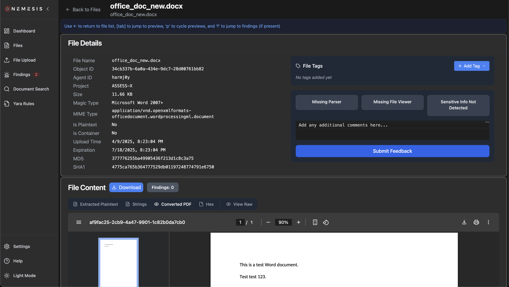

On the top left of this view, you'll see basic metadata like the file name, magic/mime types, MD5/SHA1 hashes, etc.

Press **[tab]** to bring the focus to the "File Content" area. Here, different tabs will display the summaries and transforms for a file. Pressing **[tab]** again will cycle between these preview tabs:

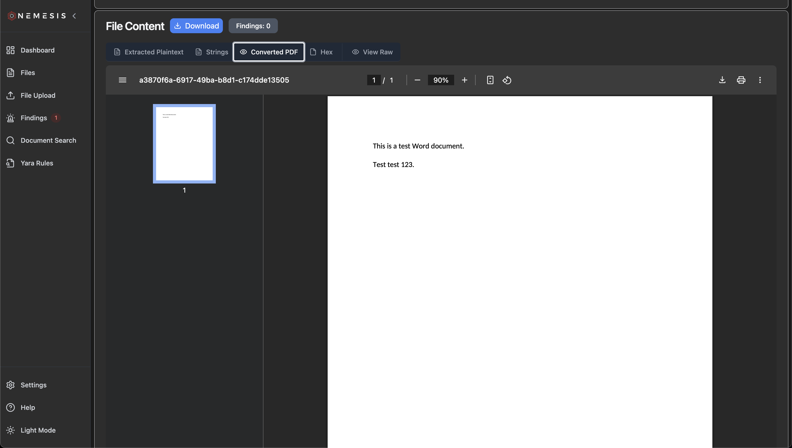

Any plaintext file identified with a specific file type will be rendered with that using the [Monaco](https://github.com/microsoft/monaco-editor) code editor:

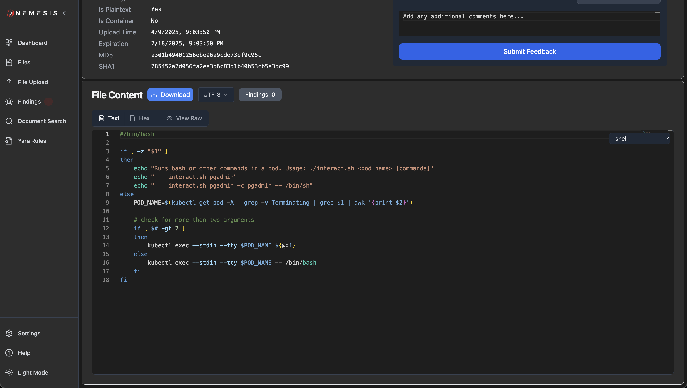

If you scroll to the bottom of the page past "File Content" you can see some basic details about the file enrichment workflow, including any successful and failed enrichments. Mousing over any failed enrichment module nodes will reveal a basic error message.

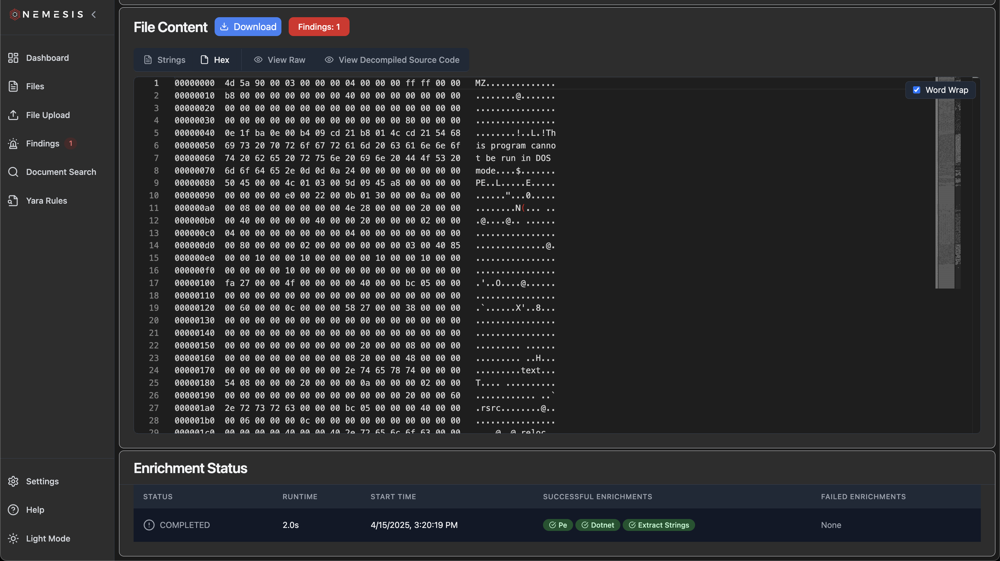

If an enrichment module is failing on your file, we recommend using [the Loki logs in Grafana](./troubleshooting.md#grafana) to help track down what's going on (tip: using the file's `object_id` UUID can help track down specific log lines).

#### File Tags

In the file details view, clicking the "+ Add Tag" button will allow you to create new tags, or add existing defined tags, to the file:

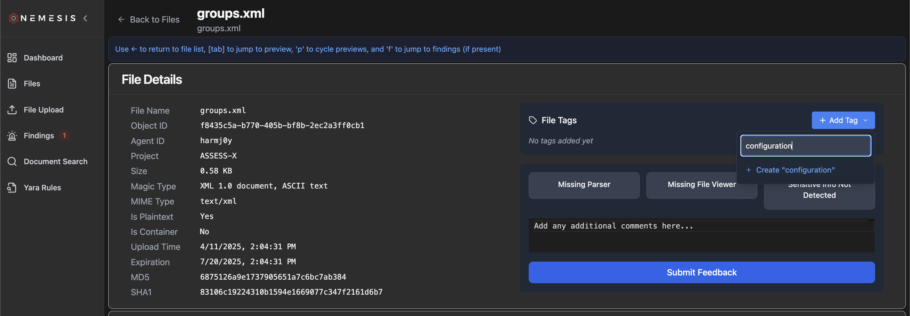

These tags will persist in the display, and can be used to filter files in the main files view:

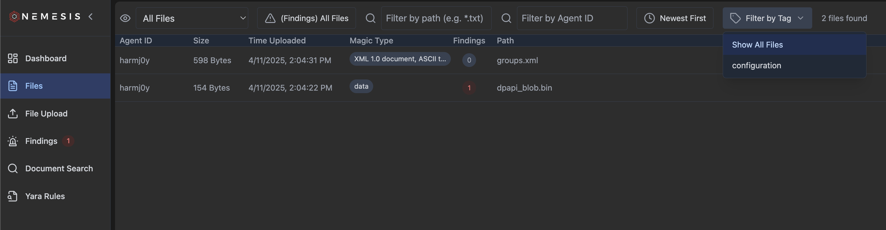

### Manual File Upload

Files can be manually uploaded through the Nemesis dashboard via the `File Upload` tab on the left navigation bar. The "Project Name" will be auto-completed, and the "Expiration Time" will be auto set for 100 days in the future (this can be changed in the "Settings" button on the bottom left). The "Originating File Path" is optional but recommended. Files can be dragged/dropped into the upload modal, and on successful submission Nemesis will display the following message:

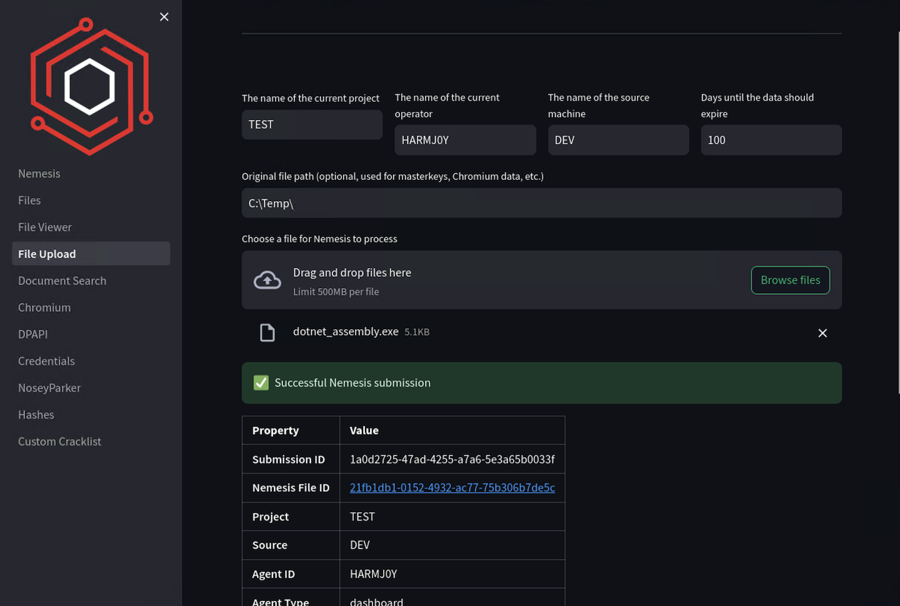

The file will then be displayed in the [Files](#files) page as soon as it's done processing.

### Document Search

Nemesis indexes the full text of any plaintext file, or the extracted plaintext of any plaintext that can have ASCII/Unicode text extracted. This is stored in the PostgreSQL backend and searchable through this interface. Partial document matches will be shown, while clicking on the file name will take you to the file details page:

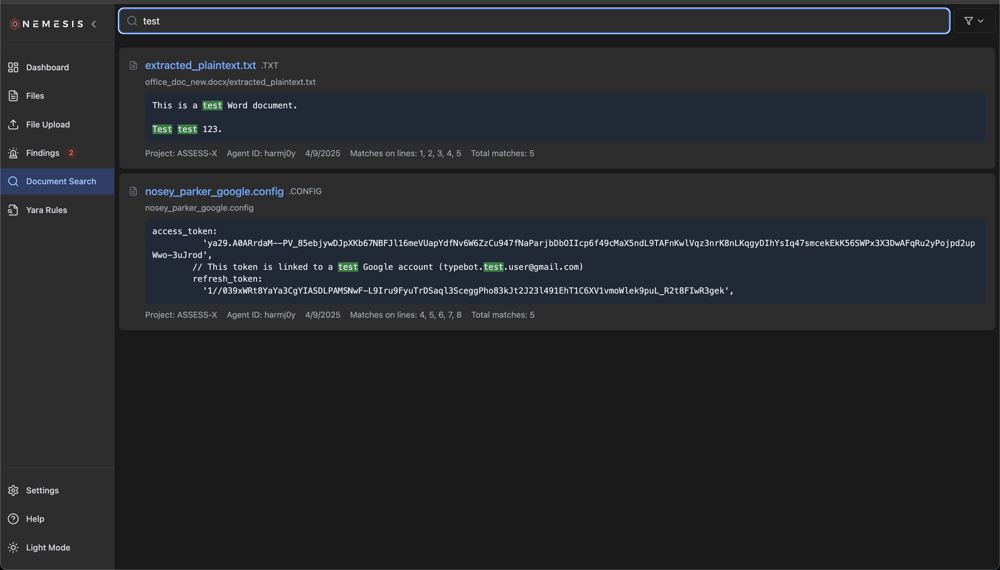

Clicking the topright filter icon will bring down filters you can apply for searches:

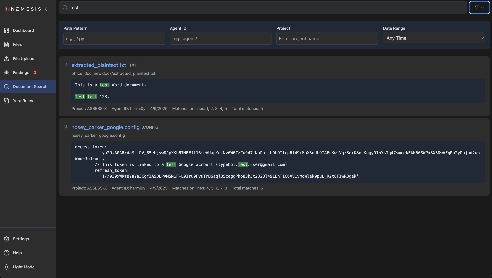

### Findings

One of the other common tasks for the dashboard is findings triage, accessible through the `Findings` page on the left navigation bar:

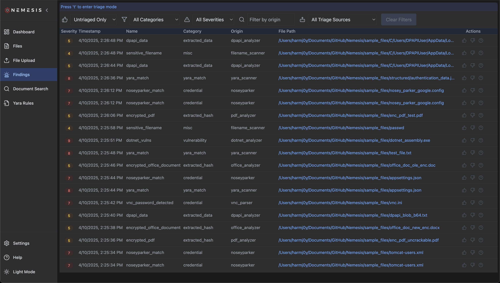

Clicking on a finding brings up details for the finding:

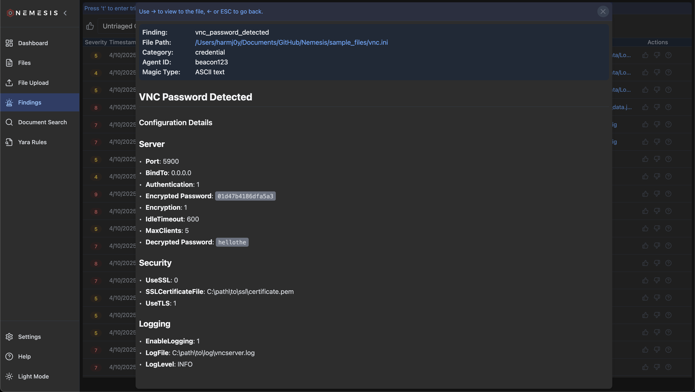

Clicking the hyperlinked file path (in the list or in the details) will take you to the file details page for the file the finding originates from. The details can be closed with the `Close` button, by clicking outside of them, or with `ESC`/`←`; the browser's Back button closes them as well.

At the top of the table you can filter findings by triage state, category, severity and triage source (human/automated), and search by finding name, category, origin module or file path. The `Clear Filters` button resets them. The triage state filter defaults to `Untriaged + Actionable`, which shows findings that are untriaged or whose latest triage is an automated "true positive" / "needs review" (e.g. from [AI triage](./agents.md)). Other options are `All Triage States`, `Untriaged Only`, `Triaged Only`, `True Positive`, `False Positive` and `Needs Review`.

Clicking any column header will sort by that column's values. Like the Files page, the findings list is paginated (100 per page), keeps its filters/sort/page in the URL, and updates live - see [Paging, Links and Live Updates](#paging-links-and-live-updates). Each row also has thumbs-up / thumbs-down / question-mark buttons to triage that single finding with the mouse.

Like with the `Files` page, type `t` to enter triage mode (and `t` again to leave it). The active row is outlined, and a ✓ marks the findings the triage keys will apply to (the selected findings, or the active row when nothing is selected). The keyboard actions are also summarized at the top of the page:

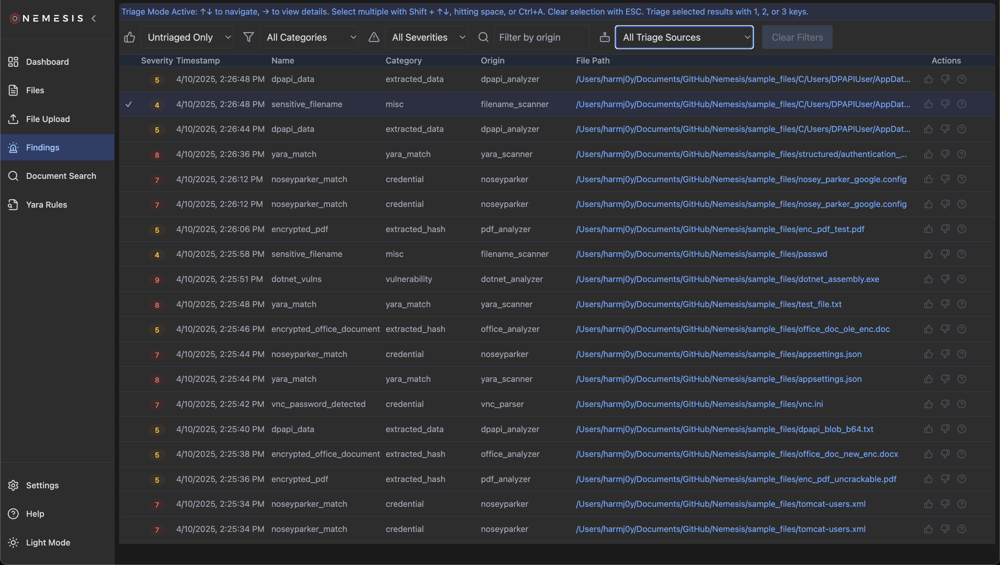

- `↑↓` - Move the active row, continuing onto the previous/next page at the edges.
- `PageUp`/`PageDown` - Jump about three quarters of the visible rows, also crossing pages (stops at the first/last result).
- `→` - View the active finding's details. Pressing `→` again while the details are open opens the finding's file; `←` or `ESC` closes the details.
- `1`, `2`, `3` - Triage as **true positive**, **false positive** or **needs review**. This applies to the selected findings if there are any, otherwise to the active row.
- `Space` - Add/remove the active row to/from the selection.
- `Shift + ↑↓` - Extend the selection up/down.
- `Ctrl/Cmd + A` - Select all findings on the current page; press it **again** to select **all** findings matching the current filters, across every page ("All N results selected").
- `Ctrl/Cmd + Mouse Click` - Add or remove a finding from the selection; `Shift + Mouse Click` selects all findings between the active row and the clicked one. These clicks don't open the details (a plain click does).
- `ESC` - Close the details if they are open; otherwise clear the selection, or, with nothing selected, exit triage mode (same as the Files page).

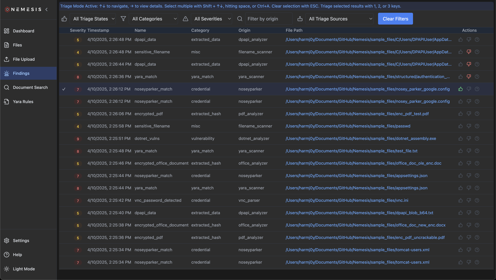

Selections behave as on the [Files page](#file-triage-mode): a page-level selection is dropped when you change pages, an "all results" selection persists across pages, and changing filters/sort, pressing `ESC` or leaving triage mode clears it. Triaging an "all results" selection first asks for confirmation ("Triage all N findings matching the current filters as true positive? Enter to confirm, Esc to cancel"), then shows a progress bar and a result message. Other keys are ignored while the prompt is shown.

Triaged findings that no longer match the current filter drop out of the list immediately, and the next finding becomes the active row. When combined with the default "Untriaged + Actionable" filter, this allows you to easily and collaboratively triage a large number of findings by pressing `1`/`2`/`3` repeatedly.

As on the Files page, the mouse-hover highlight is suppressed while navigating with the keyboard (until the mouse moves), and shortcuts are ignored while typing in the search box.

#### Keyboard Shortcuts

| Key | Page | Triage mode only | Action |
|-----|------|:----------------:|--------|
| `t` | Files, Findings | | Toggle triage mode |
| `PageUp` / `PageDown` | Files, Findings | | Scroll the list by 3/4 of its height, moving to the previous/next page at the top/bottom |
| `PageUp` / `PageDown` | Files, Findings | Yes | Move the active row by ~3/4 of the visible rows (across pages) |
| `↑` / `↓` | Files, Findings | Yes | Move the active row (across pages) |
| `Shift + ↑` / `Shift + ↓` | Files, Findings | Yes | Extend the selection |
| `Ctrl/Cmd + A` | Files, Findings | Yes | Select all rows on the page; press again to select all results |
| `→` | Files | Yes | Open the active file |
| `→` | Findings | Yes | Open the finding details; again to open its file |
| `←` | File details | | Back to the list |
| `←` / `ESC` | Findings (details open) | | Close the finding details |
| `ESC` | Files, Findings | Yes | Clear the selection; with no selection, exit triage mode (Findings: closes the details first if open) |
| `v` | Files | Yes | Mark the selected files (or the active file) as viewed |
| `Space` | Files, Findings | Yes | Toggle selection of the active row |
| `Ctrl/Cmd + Click` / `Shift + Click` | Files, Findings | Yes | Toggle a row's selection / select a range from the active row |
| `1` / `2` / `3` | Findings | Yes | Triage selected findings (or the active row) as true positive / false positive / needs review |
| `Enter` / `ESC` | Files, Findings | | Confirm / cancel a bulk action on all results |

### Dashboard Settings

Navigating to the "Settings" menu reachable in the bottom left of the Nemesis interface will take you to the settings page:

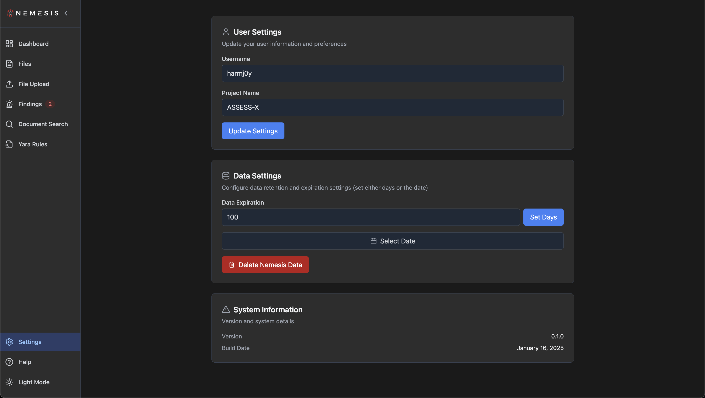

Here, you can change your username/project ID, as well as modify the data expiration (in absolute date or number of days), and can clear the Nemesis database and datalake.

Clicking the "Light Mode" or "Dark Mode" menu button in the bottom left will toggle display modes for the application

## Alerting

If Slack alerting is enabled (i.e., if the `APPRISE_URLS` ENV variable is set), alerts on "interesting" files (e.g., parsed credentials, Nosey Parker hits, DPAPI data discovery, etc.) will be pushed to the configured Slack webhook/channel with **Nemesis** as the bot user. These messages will contain the alert name, alert category, any additional details, a sanitized file path and a link to the [file details](#file-details) and finding details in the dashboard:

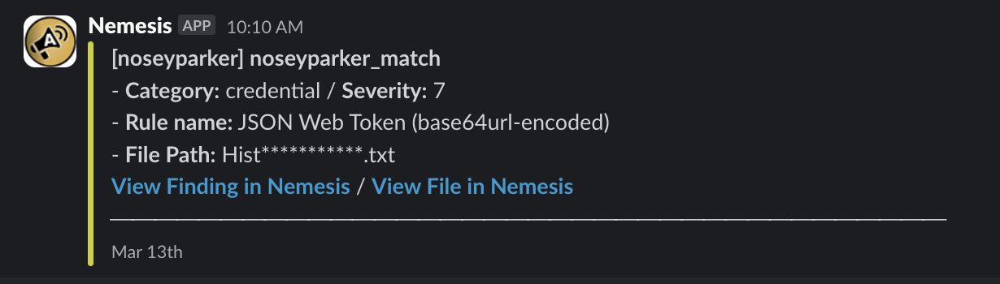

See the [Apprise Wiki](https://github.com/caronc/apprise/wiki) for the string format needed for each alerting service.

There are more details on alert configuration, filtering, and user feedback on the [Alerting](./alerting.md) page.

## Submitting Files via the API

You can submit files using Nemesis's `submit` CLI tool:
```bash
./tools/submit.sh
```

Uploading a file with curl:
```bash
curl -k -u n:n -F "file=@example.txt" \
        -F 'metadata={"agent_id":"agent123","project":"assess-test","timestamp":"2025-01-29T12:00:00Z","expiration":"2026-02-29T12:00:00Z","path":"/data/files"}' \
        https://nemesis:7443/api/files
```

### API Documentation

Navigating to the "Help" menu reachable in the bottom left of the Nemesis interface will show you the clickable `/api/docs` and `/api/redoc` Swagger and ReDoc API documentation, respectively:

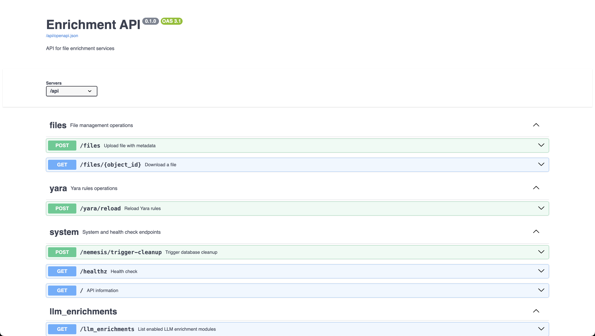

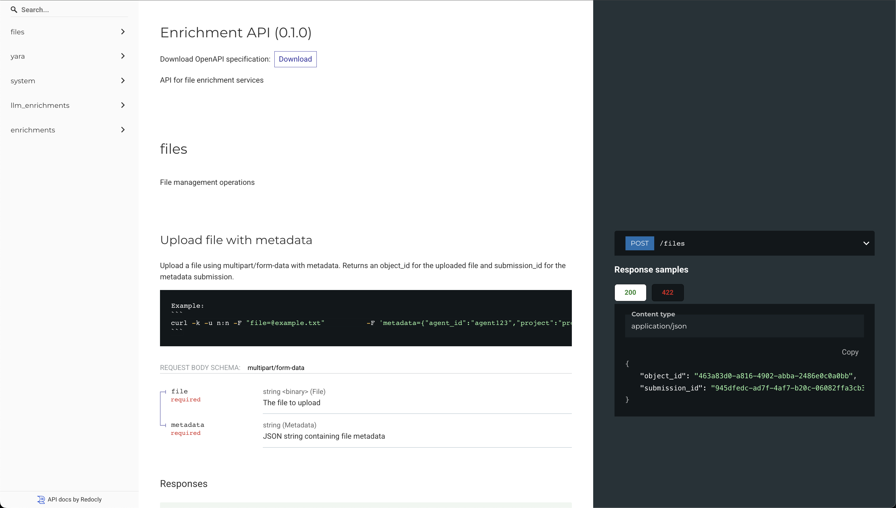

Additionally, the API documentation is dynamically rebuilt by GitHub actions when the relevant files are modified and published to [API](./api.md) for up-to-date offline access.
