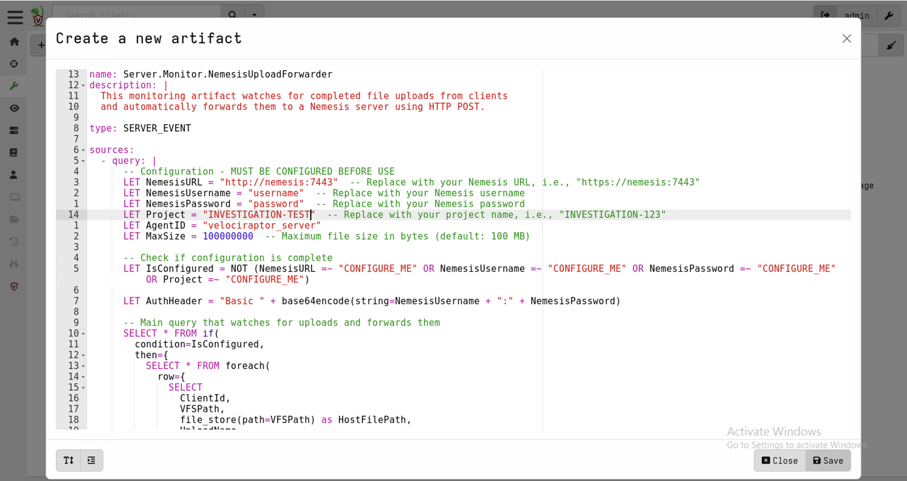
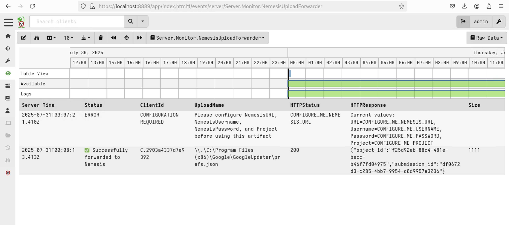

# Velociraptor Nemesis Connector

## Velociraptor Server Event Script

The `velociraptor_server_nemesis_connector.yaml` script can be [installed as a Velociraptor Server Artifact](https://docs.velociraptor.app/docs/server_automation/server_monitoring/).

### Installation

The connection settings are artifact **parameters** (no credentials are stored in the artifact definition). Add the artifact as shown below, then set the parameters when selecting it under "Server Events":
- **NemesisURL** - Your Nemesis URL, reachable from the Velociraptor server (i.e., https://nemesis:7443)
- **NemesisUsername** - Your Nemesis username
- **NemesisPassword** - Your Nemesis password (no default)
- **Project** - i.e., "INVESTIGATION-123"
- **AgentID** - optional, agent ID recorded in Nemesis, default `velociraptor_server`
- **MaxSize** - optional, maximum file size (in bytes), default of 100MB. Larger uploads are not forwarded and produce a "Skipped" row.
- **MaxAttempts** / **RetryDelay** - optional, how many times to try each upload (default 3) and the seconds to wait between attempts (default 10). An upload that fails every attempt produces a "Failed" row.
- **IgnoreCertErrors** - optional, enable to skip HTTPS certificate verification (e.g., a self-signed Nemesis certificate). Default off. Insecure: the upload and its credentials can be intercepted.

Files are submitted with `source` set to `host://<client hostname>` (falling back to the client ID when the hostname is unknown), matching the other Nemesis connectors, and `path` set to the uploaded file's path on the client.

Then Click "View Artifacts" on the left of the Velociraptor GUI, click the + to "Add an Artifact" and paste the Yaml in:

Then click "Server Events" on the left, click "Select Artifact" and select **Server.Monitor.NemesisUploadForwarder**. Details on files synchronized to Nemesis will be displayed, along with an error message if the configuration was not performed correctly.

